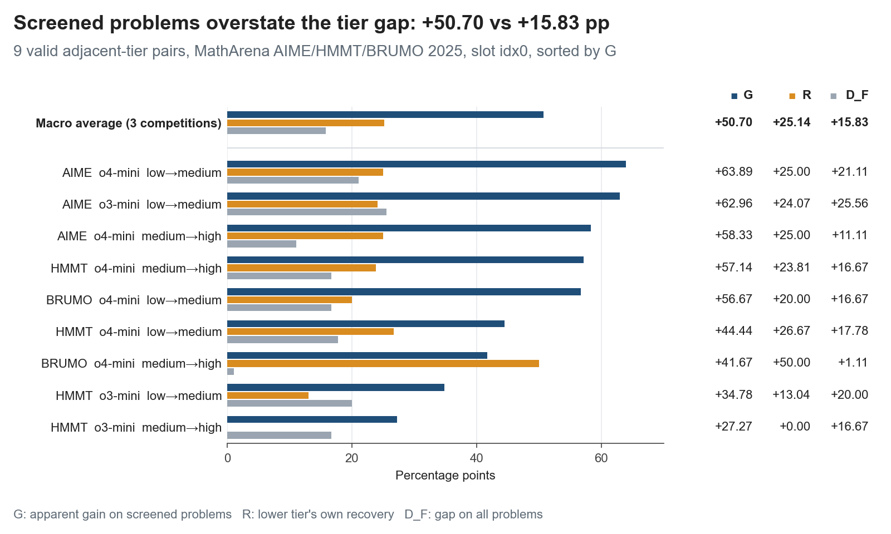

# MathArena Wrong-Answer Screening Replay

How much better does a higher reasoning tier look if you test it only on the problems the lower tier got wrong? This repo answers that by replaying MathArena's cached responses for every adjacent o3-mini and o4-mini reasoning-tier pair (low→medium, medium→high) with valid data in AIME, HMMT and BRUMO 2025, 9 pairs in all. On the screened problems the higher tier gains 50.7 percentage points on average, with each competition weighted equally. About half of that, 25.1 points, comes back on the lower tier's own other attempts at the same problems: some of its misses were bad luck, not inability. On all problems the gap is 15.8 points.



---

## 1. Research question

Benchmarks are often built by keeping the problems that some reference model gets wrong. When a newer configuration B is then compared with the reference configuration A on those problems, part of B's apparent gain is regression to the mean: A itself would have recovered some of them on a fresh attempt. This repository measures that effect on MathArena's cached responses, where most model configurations answered every problem four times (`idx` 0–3).

1. On problems that A answered wrong in its screening attempt, how much of B's gain is recovered by A's own other attempts?
2. How does the remaining configuration gap on the screened problems compare with the gap on all problems?
3. Across every adjacent reasoning-tier pair of the same base model in the 2025 final-answer competitions processed here, how large are these quantities and how often do they change sign?

## 2. Definitions

The analysis plan for each run, including these definitions, was fixed before any correctness value was read. For each problem, one attempt is the screening slot and the other three are re-scoring slots. The Claude-pair run assigns the screening slot by a hash-based rotation (`p0`); the HMMT o3-mini run and the all-pairs run fix it at `idx0`.

- `A₀`: correctness of A's screening attempt (0/1).
- `A₁`, `B₁`: mean correctness of A and of B over the three re-scoring attempts. B's screening-slot attempt is not used, so both sides are scored on the same number of attempts.
- `S = {problems with A₀ = 0}`, `K = |S|`. G, R, D are undefined when K = 0.
- **G** = mean over S of `(B₁ − A₀)`: the apparent gain of B on the screened problems (called `G_naive` in the Claude-pair run).
- **R** = mean over S of `(A₁ − A₀)`: recovery by A's own re-scoring attempts after screening.
- **D** = mean over S of `(B₁ − A₁)`: the configuration gap on the screened set. `G − R = D` holds exactly.
- **D_F** = mean over the complete frame F (all problems with full records) of `(B₁ − A₁)`: the configuration gap on all problems.
- **C** = `D − D_F`: the composition difference created by screening. The all-pairs run also reports `G − D_F` (`= R + C`) and the sign-reversal flag `1[D · D_F < 0]`.

All quantities are computed as exact fractions on a fixed, finite set of records and reported in percentage points (pp). A four-slot rotation of the screening slot is reported as a sensitivity analysis.

Aggregation in the all-pairs run (fixed weights): within each competition, average the valid adjacent pairs of a base model with equal weight, then average base models with equal weight; the macro average gives equal weight to each competition with at least one valid pair.

## 3. Main results

The analysis was run first on one Claude pair, then on one o3-mini pair, then on every adjacent reasoning-tier pair; the subsections below present them from the all-pairs run back to the Claude-pair run.

### 3.1 All adjacent reasoning-tier pairs

Results are in `results/all_pairs/tables/pairs_all.csv` and `results/all_pairs/tables/aggregates.csv`.

- Four 2025 competitions were processed: AIME, HMMT Feb, BRUMO and CMIMC, with 210 configurations in all. Pairing adjacent reasoning tiers of the same base model yields 12 adjacent-tier pairs, all from the `o3-mini` and `o4-mini` base models. A pair is valid when, for every problem, all four attempts are present on both sides and the prompts are identical across the two tiers. The 9 valid pairs come from AIME, HMMT and BRUMO. The other 3 (AIME `o3-mini` medium→high and both CMIMC pairs) are excluded because the prompts differ between the two tiers.
- Across the 9 valid pairs (screening slot `idx0`), R ranges from +0.00 to +50.00 pp and C from −9.44 to +22.22 pp (7 positive, 1 zero, 1 negative). D and D_F have strictly opposite signs in 1 of 9 pairs (BRUMO `o4-mini` medium→high, K = 4).
- Fixed-weight macro averages over the three competitions:

| Set | G | R | D | D_F | C = D − D_F | G − D_F |
|---|---:|---:|---:|---:|---:|---:|
| All valid pairs | +50.70 | +25.14 | +25.57 | +15.83 | +9.73 | +34.87 |
| Excluding the pair already used in the HMMT o3-mini run | +51.33 | +26.23 | +25.10 | +16.11 | +8.99 | +35.22 |

After recovery, the remaining gap D on the screened problems is still larger than the all-problem gap D_F.

- The results were recomputed with a separate Parquet decoder and a separate implementation of the tier rule, the completeness check and the aggregation (`code/all_pairs/independent_recompute.py`); every item agrees. A second recomputation with its own Parquet decoder is in `code/all_pairs_recompute/`, with output `results/all_pairs_recompute/second_recompute.json`.

### 3.2 One pair in detail: HMMT Feb 2025, o3-mini medium vs high

Results of the HMMT o3-mini run, with A = o3-mini (medium) and B = o3-mini (high), are in `results/hmmt_o3mini_pair/tables/four_slot_cycle.csv`.

K = 11 of 30 problems; G = +27.27 pp, R = +0.00 pp (0 of 33 re-scoring attempts correct), D = +27.27 pp; D_F = +16.67 pp, C = +10.61 pp.

### 3.3 A first run on another model pair: AIME 2025, Claude-3.5-Sonnet vs Claude-3.7-Sonnet (Think)

Results of the Claude-pair run, with A = Claude-3.5-Sonnet and B = Claude-3.7-Sonnet (Think), are in `results/claude_pair/tables/rotations.csv`.

K = 28 of 30 problems; G = 10/21 (+47.6 pp), R = 1/84 (+1.2 pp), D = 13/28 (+46.4 pp); D_F = 41/90 (+45.6 pp), C = 11/1260 (+0.9 pp). A answers 4 of 120 attempts correctly.

## 4. Data sources

Cached model responses published by MathArena on Hugging Face, license **cc-by-nc-sa-4.0**. The data are not redistributed in this repository, and per-item tables derived from them (slot-level correctness and slot listings) are omitted; the scripts regenerate those tables from the data. Download the data at the pinned revisions:

| Competition | Dataset | Revision |
|---|---|---|
| AIME 2025 | `MathArena/aime_2025_outputs` | `16e93d3bb9b0a25ea9422893464d46b3c5ff0ae9` |
| HMMT Feb 2025 | `MathArena/hmmt_feb_2025_outputs` | `e3fb6c74f24eabf83413eb9e62b9816c1f3f7d2e` |
| BRUMO 2025 | `MathArena/brumo_2025_outputs` | `3b234efea64d03f80ec57a85e29879fc41b04864` |
| CMIMC 2025 | `MathArena/cmimc_2025_outputs` | `27826187da75fb124dca803cc0274d3c5694df5c` |

Each dataset is a single file `data/train-00000-of-00001.parquet`, e.g.
`https://huggingface.co/datasets/MathArena/aime_2025_outputs/resolve/16e93d3bb9b0a25ea9422893464d46b3c5ff0ae9/data/train-00000-of-00001.parquet`.

The scripts expect the files at:

```
downloads/hf_aime_2025_outputs_16e93d3/train-00000-of-00001.parquet       (Claude-pair run and all-pairs run)
downloads/hf_hmmt_feb_2025_outputs_e3fb6c7/train-00000-of-00001.parquet   (HMMT o3-mini run and all-pairs run)
downloads/hf_brumo_2025_outputs_3b234ef/train-00000-of-00001.parquet      (all-pairs run)
downloads/hf_cmimc_2025_outputs_2782618/train-00000-of-00001.parquet      (all-pairs run)
```

The first-step scripts of each run also read metadata snapshots saved at run time (Hugging Face revision info and file trees, MathArena config history on GitHub) from `downloads/meta_web_claude_pair/`, `downloads/meta_web_hmmt_o3mini_pair/` and `downloads/meta_web_all_pairs/`; these snapshots are not included.

## 5. Repository layout

```
code/
  pq_reader.py                                 pure-Python Parquet reader
  claude_pair/                                 Claude-pair run
    claude_pair_rules.py, build_frame.py       problem frame and slot roles (correct column masked)
    compute_quantities.py                      read correct, compute G, R, D, D_F and the tables
    test_claude_pair.py                        unit tests
    diag/                                      diagnostics (record mechanism, official-page accuracy check)
  hmmt_o3mini_pair/                            HMMT o3-mini run: build_frame -> compute_quantities -> independent_recompute, tests
  all_pairs/                                   all-pairs run: build_frame -> compute_quantities -> independent_recompute, probes, prompt diagnostic, tests
  all_pairs_recompute/                         second independent recomputation of the all-pairs run (own Parquet decoder)
results/
  claude_pair/tables/                          rotations, per-problem table
  claude_pair/diag/                            official-page accuracy check
  hmmt_o3mini_pair/tables/                     four-slot cycle, per-problem table
  hmmt_o3mini_pair/independent_recompute.json  independent recomputation
  all_pairs/frame/                             configs, endpoints, pairs, near-miss notes (written before reading correct)
  all_pairs/tables/                            all pairs (pairs_all.csv), aggregates, four-slot cycle
  all_pairs/independent_recompute.json         independent recomputation
  all_pairs_recompute/second_recompute.json    second independent recomputation
```

## 6. Reproduction

Requirements: Python 3.10 or later. The scripts of the three runs use the standard library; the second recomputation in `code/all_pairs_recompute/` also needs the `zstandard` package.

1. Download the Parquet files listed in section 4 into `downloads/` at the pinned revisions.
2. Claude-pair run, from `code/claude_pair/`:
   ```
   python -X utf8 -I test_claude_pair.py
   python -X utf8 -I build_frame.py                    # step 1: problem frame and slot roles (reads downloads/meta_web_claude_pair/)
   python -X utf8 -I compute_quantities.py             # step 2: read correct, compute -> results/claude_pair/tables/
   python -X utf8 -I diag/d2_official_page_check.py    # official-page check -> results/claude_pair/diag/ (reads downloads/meta_web_claude_pair/)
   ```
3. HMMT o3-mini run, from `code/hmmt_o3mini_pair/`:
   ```
   python -X utf8 -I -B build_frame.py             # config correspondence and problem frame
   python -X utf8 -I -B compute_quantities.py      # read correct, compute -> results/hmmt_o3mini_pair/tables/
   python -X utf8 -I -B independent_recompute.py   # -> results/hmmt_o3mini_pair/independent_recompute.json
   ```
4. All-pairs run, from `code/all_pairs/`:
   ```
   python -X utf8 -I -B build_frame.py             # metadata only: configs, tiers, pairs, completeness check -> results/all_pairs/frame/
   python -X utf8 -I -B compute_quantities.py      # decode correct, per-pair quantities and aggregates -> results/all_pairs/tables/
   python -X utf8 -I -B independent_recompute.py   # -> results/all_pairs/independent_recompute.json
   ```
5. Second recomputation, from the repository root (after step 4):
   ```
   python code/all_pairs_recompute/recompute.py           # -> results/all_pairs_recompute/second_recompute.json
   python code/all_pairs_recompute/compare_with_main.py   # prints any disagreement with results/all_pairs/frame/ and tables/
   ```

## License

Code and text in this repository: MIT, see `LICENSE`. The MathArena data are licensed separately (cc-by-nc-sa-4.0) and are not covered by this license.
